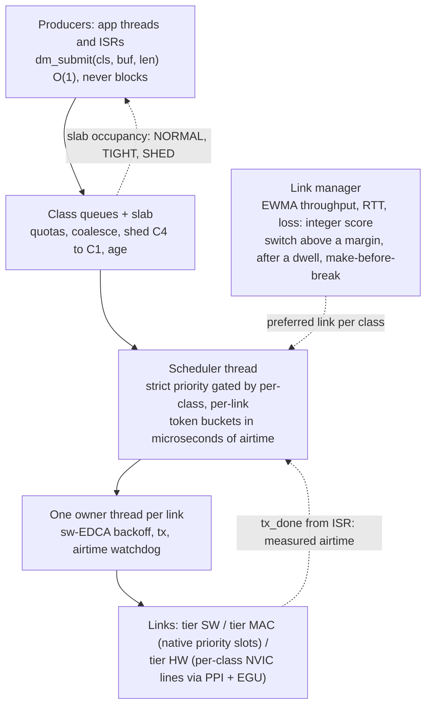

# Dockmaster

[](https://github.com/nurzaman7/dockmaster/actions/workflows/ci.yml)
[](LICENSE)


**Firmware QoS for multi-radio Cortex-M devices on Zephyr.** One traffic-class
table, one airtime scheduler and one link selector for a device that carries
several radios (an on-chip 802.15.4 or BLE radio, an external sub-GHz PHY,
a cellular modem), enforced from thread priorities down to NVIC priorities.

A field device with three radios usually has three queues and no shared
notion of priority. A firmware-update chunk sits in front of an alarm; bulk
logs drain over the metered modem because it happened to be up; one radio
failing takes the device's control traffic with it. Dockmaster gives every
outbound message a class and makes one component responsible for when, where
and whether it goes out:

| Class | Meaning | Default treatment |
| --- | --- | --- |
| **C0** control | commands, acks, alarms | never shed or aged out; duplicated on the two best links; retried on failure; may overdraw its airtime budget once |
| **C1** state | telemetry where only the latest value matters | coalesced by key (freshest wins); the newest value of a key is re-queued if it fails |
| **C2** media | audio, image frames | per-message deadline; prefers non-metered links |
| **C3** events | logs and events | queued; refused under heavy pressure |
| **C4** bulk | file transfer, firmware | first to be shed; never sent over a metered link |

## How it works



- **Budgets are airtime, not bytes.** Each driver provides a pure
  `cost_of_us(len)`; buckets are milliseconds of air per second, so one
  policy fits a 250 kbit/s radio and a 5 kbit/s PHY, and a duty-cycle limit
  is just a bucket rate. The estimate is reserved at dispatch and the
  measured airtime charged on completion. ([ADR 0001](doc/adr/0001-airtime-units.md))
- **Producers never wait.** `dm_submit()` is one slab allocation, one copy
  and one ring append, safe from an ISR. Anything O(queue depth) (coalesce,
  shed) returns `-EAGAIN` from an ISR instead of spinning.
- **One owner thread per link** is the only context that touches that
  radio; a watchdog of four times the estimated airtime catches a missing
  completion.
- **The link manager uses what Dockmaster measures** (delivered throughput,
  probe RTT, loss), never the modem's own RSSI. Scores are integers in
  0..1000; switching needs a 20 % margin, a per-class dwell (0 s for C0,
  5 min for C4) and a passed probe on the new link.
- **Pressure is one number** (slab occupancy) driving NORMAL, TIGHT (C4
  refused), SHED (C3 refused, proactive shed, C1 coalesce forced) and
  CRITICAL (a C0 message was lost), with hysteresis and one producer hint
  per transition.
- **Policy is data**: a 214-byte, CRC-protected, versioned struct applied
  atomically at run time, stored in two slots, and reverted automatically if
  the device reboots twice inside the trial window.
- **Priorities are a plan, not folklore**: the class table maps to thread
  priorities and, on SoCs that can route events, to NVIC levels; init-time
  asserts reject a configuration that breaks the plan.

The full design is in [doc/spec.md](doc/spec.md), the threading model in
[doc/architecture.md](doc/architecture.md).

## Results

Every rule in the spec has a named ztest. **52 test cases pass on both
`native_sim` and a Cortex-M3** (`mps2/an385` under QEMU, where timer
interrupts really preempt threads), and the policy suite passes again over
Settings on NVS. Highlights from the suites
([doc/testing.md](doc/testing.md)):

- exact token balances with a fake clock: C0 overdraw then recovery,
  measured airtime replacing the estimate, refill across tick wraparound;
- shed order C4, C3, C2, C1 and never C0; coalesce in place; ISR path;
- link manager: margin and dwell, make-before-break cancelled by a failed
  probe, a DOWN link excluded until it passes a probe;
- policy: every invalid field rejected with nothing applied, auto-revert
  after two quick reboots, atomic apply under a concurrent producer;
- a 10,000-iteration property test: whatever the load, C0 is never lost.

The integration test runs the real threads for 60 s at five times nominal
load, with the radio failing every 7 s and the metered link losing 10 % of
frames. On the Cortex-M3:

| | C0 control | C1 state | C2 media | C3 events | C4 bulk |
| --- | --- | --- | --- | --- | --- |
| accepted | 300 | 3000 | 6000 | 288 | 544 |
| delivered | **300 (all)** | 923, newest of every key | 1908 | 192 | 544, **0 bytes on the metered link** |
| how the overload was absorbed | untouched | 2077 coalesced | 4068 shed or deadline-dropped | 312 refused, 83 shed | 2456 refused at the door |

`submitted = sent + failed + dropped + coalesced` holds for every class, and
the slab is empty at the end.

The native sample shows the same behaviour in 12 s:

```text
dockmaster up: radio is link 0, cellular (metered) is link 1
link 0 down (radio fails for 3 s)
<wrn> dm: pressure NORMAL -> TIGHT
<wrn> dm: pressure TIGHT -> SHED
<wrn> dm: pressure SHED -> TIGHT
link 0 up
<wrn> dm: pressure TIGHT -> NORMAL

class  submitted  refused  sent  failed  dropped(quota/age/shed)  coalesced  airtime_ms
C0            12        0    12       0       0/  0/   0                  0         285
C1           120        0    57       0       0/  0/   0                 63         405
C2           240        0   137       4       0/ 99/   0                  0        2324
C3            22        2    21       1       0/  0/   0                  0         446
C4           459      141   436      21       0/  0/   2                  0        3290

C0 delivered 12/12, lost 0
C4 bytes on metered link: 0
```

Measured costs on the Cortex-M3 model are in
[doc/deviations.md](doc/deviations.md#timing-measurements). In short,
`dm_submit()` costs the same at queue depth 0 and 15 (O(1)), and the
hardware-latency targets are pending the hardware labs below.

## Quick start

```sh
pip install west
west init -m https://github.com/nurzaman7/dockmaster --mr main dm-workspace
cd dm-workspace && west update --narrow -o=--depth=1
pip install -r zephyr/scripts/requirements.txt

# run the demo on the host (Linux)
west build -b native_sim dockmaster/samples/two_links_native -t run

# every test, on the host and on the Cortex-M3 model
west twister -T dockmaster/tests -p native_sim -p mps2/an385
```

To use it in an existing workspace, add the module to your `west.yml`:

```yaml
    - name: dockmaster
      url: https://github.com/nurzaman7/dockmaster
      revision: main
```

and enable it with `CONFIG_DOCKMASTER=y`.

### Producer

```c
#include <dockmaster/dm.h>

void report_temperature(int16_t centi_c)
{
	struct dm_submit_opts o = {.coalesce_key = SENSOR_TEMP, .link_hint = DM_LINK_ANY};

	/* Never blocks: a full queue is a return code, not a wait. */
	(void)dm_submit(DM_C1, &centi_c, sizeof(centi_c), DM_F_COALESCE, &o);
}
```

### Link driver

```c
static const struct dm_link_ops ops = {
	.tx = my_tx,                 /* start and return; complete from the ISR */
	.cancel = my_cancel,
	.cost_of_us = my_cost_of_us, /* pure airtime model */
	.probe = my_probe,
	.is_busy = my_cca,           /* enables sw-EDCA on tier SW links */
};

/* In the radio's done ISR, ISR safe: */
dm_link_tx_done(link, handle, status, 0 /* 0: Dockmaster measures the airtime */);
```

## Repository layout

```text
include/dockmaster/      public API: dm.h (producers, policy), dm_link.h (drivers), dm_stats.h
subsys/dockmaster/       core: queues, scheduler, owner threads, link manager, policy, pressure
  hw/                    DM_TIER_HW backends (nRF GPIOTE -> PPI/DPPI -> EGU)
drivers/dockmaster_link/ fake link, generic SPI PHY, UART co-processor, on-chip 802.15.4
dts/bindings/            dockmaster,link and driver bindings
samples/                 two_links_native (demo, CI smoke test), hardware lab samples
tests/unit/              queue, sched, linkmgr, policy, pressure, prio (ztest)
tests/integration/       two_links: 60 s fault-injection run
doc/                     spec, architecture, testing, deviations, ADRs (Sphinx + Doxygen)
```

## Status

Where the implementation resolved a gap or contradiction in the spec, the
decision is written down in [doc/deviations.md](doc/deviations.md) and the
[ADRs](doc/adr/index.md).

## License

Apache-2.0, like Zephyr.
