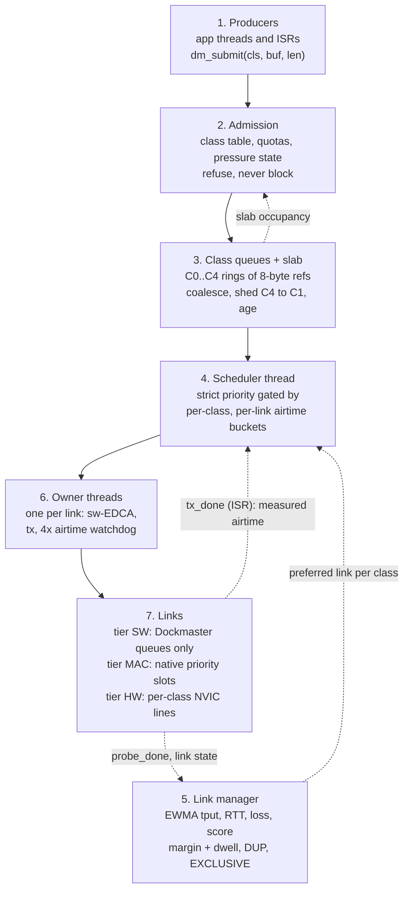

# Architecture

Dockmaster sits between the application and the radios. Producers hand it
messages tagged with a class; it decides when, on which link and whether at
all each message is transmitted. Data flows down through seven layers. The
only upward path is the slab occupancy signal, which drives admission and
the producer hints.

## Threads and contexts

| Context | Priority (default) | Does | Never does |
| --- | --- | --- | --- |
| Producer thread or ISR | application (8+) or any IRQ | `dm_submit()`: one slab alloc, one copy, one ring append | wait, allocate from the heap, touch a radio |
| `dm_sched` | 4, preemptible | settle completions, re-score links, age and shed, pick and dispatch | block on a radio, run on the system workqueue |
| Owner thread, MAC link | 5 | sw-EDCA (SW tier only), `ops->tx`, wait for its own completion | touch another link |
| Owner thread, SW link | 6 | same | |
| Owner thread, metered link | 7 | same | run above the others |
| Driver ISR | `DM_IRQ_LINK` or `DM_IRQ_HW_*` | read and clear the event, `dm_link_tx_done()` | log above DBG, schedule, compute airtime models |

The scheduler is the only thread that pops class queues during normal
operation. Producers append; a producer that needs a shed takes the consumer
lock with try semantics and simply skips the shed if the scheduler holds it.
Every ring operation is O(1) under a short `irq_lock`.

## Life of a message

1. `dm_submit(C2, buf, 100, DM_F_DROP_LATE, &opts)` copies the payload into a
   256-byte slab block (16-byte header, up to 240 bytes of payload) and
   appends an 8-byte reference to the C2 ring. If the ring was empty the
   scheduler is signalled.
2. The scheduler wakes (`k_poll` on one signal), drains completions, lets the
   link manager re-score, drops expired heads, then for every idle link
   walks C0 to C4 and takes the first class that has a message, affinity for
   that link and enough tokens for `cost_of_us(len)`.
3. The estimate is reserved from the bucket and the reference goes to the
   link's owner thread through a depth-2 `k_msgq`.
4. The owner thread runs sw-EDCA if the link is tier SW and exposes
   `is_busy`, calls `ops->tx`, and blocks on its own semaphore with a
   watchdog of four times the estimated airtime.
5. The driver's ISR calls `dm_link_tx_done(link, handle, status, airtime)`.
   The owner thread posts the completion to the scheduler, which credits the
   estimate back, debits the measured airtime, updates the link's EWMAs and
   frees the block (or, for C0, retries it; for C1, re-queues it if it is
   still the newest value of its key).

## Enforcement tiers

| Tier | Separation | Example |
| --- | --- | --- |
| `DM_TIER_SW` | Dockmaster's queues and buckets; optional sw-EDCA on the medium | external PHY over SPI, modem over UART |
| `DM_TIER_MAC` | plus the MAC's own priority slots via `mac_prio` | on-chip 802.15.4 (direct vs CSMA-CA) |
| `DM_TIER_HW` | plus per-class completion interrupts at different NVIC levels | nRF GPIOTE to PPI/DPPI to EGU, C0 at level 1, C4 at level 3 |

## Memory, default configuration

| Item | Size |
| --- | --- |
| Slab | 32 blocks x 256 B = 8 KiB |
| Class rings | 64 refs x 8 B = 512 B |
| Per link | owner stack 2 KiB + about 300 B of state |
| Scheduler | 1.5 KiB stack |

On `mps2/an385` (Cortex-M3) the native sample with two links links to about
59 KB of flash and 37 KB of RAM including the kernel, logging and the
sample's own buffers.
